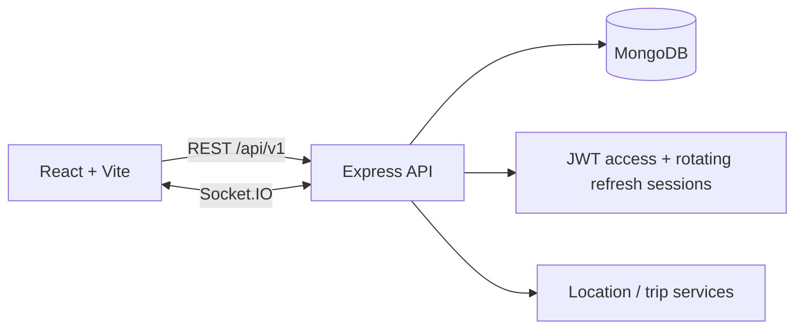

# RideTogether

RideTogether helps a group coordinate a shared trip: members join with a trip code, share opt-in browser GPS while a trip is active, and coordinate using a map, chat, checkpoints, and trip-scoped emergency alerts.

> **Location and emergency limitations:** Location is only shared after the rider grants browser permission and enables sharing. Mobile browsers may suspend GPS when a tab is backgrounded or the device sleeps. SOS and other alerts notify trip members; they do not contact emergency services.

## Features

- Email/password registration and login with short-lived access JWTs and one-time rotating HttpOnly refresh sessions.
- Private trip creation, human-readable invitation codes, membership, leader controls, and lifecycle states.
- Capacity-safe concurrent joins and server-side role/membership checks.
- Opt-in GPS sharing, latest locations, sampled route history, location freshness indicators, and reconnect snapshots.
- Trip-specific paginated chat, checkpoint creation and arrival reporting, and SOS/breakdown/medical events.
- Persistent in-app notifications for trip membership, lifecycle, checkpoint, and emergency updates.
- Password changes with refresh-session rotation and revocation of other sessions.
- Responsive React pages, free OpenStreetMap tiles with attribution, desktop and mobile layouts.
- 30-day sampled GPS-history retention via a MongoDB TTL index.

## Architecture



The browser stores the short-lived access token in memory. Refresh tokens are opaque, rotated on every refresh, stored hashed in MongoDB, and sent only in an HttpOnly cookie. MongoDB stores trip data, messages, latest locations, and sampled location history.

## Requirements

- Node.js 20 or newer and npm.
- MongoDB 7 or newer, local or hosted. A standalone local server is supported for development; multi-document transactions require a replica set (MongoDB Atlas is suitable).

## Local development

1. Start MongoDB, then configure the environment:

   ```powershell
   Copy-Item server\.env.example server\.env
   Copy-Item client\.env.example client\.env
   ```

   Replace both server secret placeholders with independent random values. Do not commit `.env` files.

2. Install dependencies if needed:

   ```powershell
   Set-Location server
   npm ci
   Set-Location ..\client
   npm ci
   ```

3. In separate terminals, start the API and frontend:

   ```powershell
   Set-Location server
   npm run dev
   ```

   ```powershell
   Set-Location client
   npm run dev
   ```

   Open <http://localhost:5173>. The API health checks are <http://localhost:5000/api/v1/health> and <http://localhost:5000/health>.

### Open the app from another device on your network

The development server binds to all network interfaces, and API/socket requests use same-origin Vite proxies. Find this computer's private IPv4 address (for example with `ipconfig` on Windows), then open `http://<computer-ip>:5173` on the other device. Do not use `localhost` on the phone or other computer; that points back to that device itself. If Windows Firewall prompts, allow Node.js on your private network. Keep both development servers running.

## Configuration

See [`server/.env.example`](server/.env.example) and [`client/.env.example`](client/.env.example). Local development leaves `VITE_API_URL` and `VITE_SOCKET_URL` blank so REST and Socket.IO use the current browser host through Vite's proxies. If connecting the browser directly to the API, set those URLs to the computer's LAN IP instead of `localhost`. In production, set `CLIENT_URL` (or comma-separated `CLIENT_URLS`) to the exact HTTPS frontend origin and set `COOKIE_SECURE=true`.

API and Socket.IO rate limits are disabled as requested. Do not expose this configuration to an untrusted public network: login brute-force and resource-exhaustion protections are not provided.

The server creates Mongoose indexes automatically. MongoDB TTL deletion is asynchronous: expired sampled location history is removed by MongoDB's TTL monitor, not immediately at the 30-day boundary.

## Tests and checks

```powershell
Set-Location server
npm test
npm run lint

Set-Location ..\client
npm test
npm run lint
npm run build
```

Backend integration tests use `mongodb-memory-server`; its MongoDB binary must be available or downloadable. Client tests use Vitest, jsdom, and Testing Library.

## API and data reference

- [REST and Socket.IO API](docs/API.md)
- [MongoDB models, authorization, and retention](docs/DATA_MODEL.md)
- [Demo walkthrough](docs/DEMO.md)

The REST API base is `/api/v1`. Internal routes use MongoDB trip IDs; invitation and join flows use the human-readable `tripCode`.

## Known limitations

- A browser cannot guarantee continuous background GPS. For reliable screen-off tracking, a native mobile client is needed.
- The OpenStreetMap tile layer shows the origin/destination connector, not turn-by-turn routing. The selected tile endpoint requires no API key; respect its tile-usage policy. No routing provider is configured.
- Location-history distance is not presented as measured trip distance; sparse samples are not a reliable odometer.
- Demo seeding creates clearly labeled example accounts and must never be run against production.
- Production deployment, domain/TLS setup, MongoDB backups, monitoring, and an external multi-instance Socket.IO adapter must be configured by the operator.

## Future work

Native background location, route-provider integration, push notifications, richer arrival analytics, automated deployment pipelines, and Redis-backed Socket.IO scaling.
